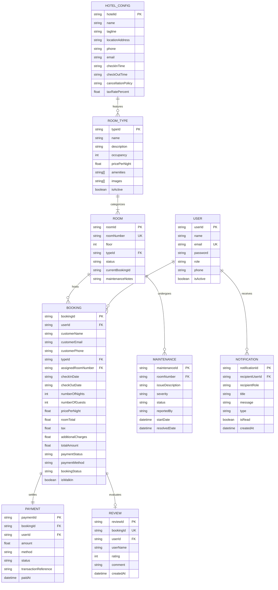

# Hotel Saravana Grand – Single Hotel Management & Online Reservation System
## Placement-Level Project Architecture & Technical Documentation

---

## 1. Executive Project Summary
* **Application Title**: Single Hotel Management & Online Reservation System
* **Hotel Property**: Hotel Saravana Grand (Madurai, Tamil Nadu)
* **Architecture**: 3-Role Decoupled Single-Hotel Architecture (Customer, Receptionist, Manager)
* **Backend Stack**: Node.js, Express.js (ES Modules), JWT (`jsonwebtoken`), Password Hashing (`bcryptjs`), Mongoose / MongoDB with unified In-Memory ACID Repository.
* **Frontend Stack**: React 19, Vite, Tailwind CSS, React Router DOM v7, Lucide Icons, Canvas Confetti.
* **Security & Concurrency**: Cryptographic JWT Bearer Token validation, strict role-based access control (RBAC), customer data isolation (anti-IDOR), interval overlap mathematical checks, and double-booking race condition prevention.

---

## 2. The 3 System Roles & Permissions Matrix

| Capability / Resource | Customer | Receptionist | General Manager / Owner | Technical Enforcement |
| :--- | :---: | :---: | :---: | :--- |
| **View Hotel Profile & Policies** | ✅ Read | ✅ Read | ✅ Update Details | `GET /api/hotel` (Public), `PUT /api/hotel` (`requireRole(['manager'])`) |
| **Search Date Availability** | ✅ Read | ✅ Read | ✅ Read | `GET /api/rooms/availability` with Date Overlap Engine |
| **Online Chamber Reservation** | ✅ Self | ❌ N/A | ❌ N/A | `POST /api/bookings` with atomic concurrency verification |
| **Personal Booking History** | ✅ Self only | ❌ N/A | ❌ N/A | `GET /api/bookings/my-bookings` strictly scoped to `req.user.userId` |
| **Front Desk Walk-In Booking** | ❌ N/A | ✅ Full | ✅ Full | `POST /api/bookings/walk-in` (`requireRole(['receptionist', 'manager'])`) |
| **Guest Check-In & Room Assignment** | ❌ N/A | ✅ Full | ✅ Full | `PATCH /api/bookings/:id/check-in` |
| **Guest Check-Out & Extra Billing** | ❌ N/A | ✅ Full | ✅ Full | `PATCH /api/bookings/:id/check-out` |
| **Room Status Board (Cleaning, etc.)**| ❌ N/A | ✅ Operational | ✅ Operational | `PATCH /api/rooms/physical/:roomNumber/status` |
| **Room Pricing & Inventory Config** | ❌ N/A | ❌ N/A | ✅ Full Control | `POST /api/rooms/types`, `POST /api/rooms/physical` |
| **Staff Account Management** | ❌ N/A | ❌ N/A | ✅ Full Control | `POST /api/manager/staff`, `PATCH /api/manager/staff/:id/status` |
| **Room Maintenance Scheduling** | ❌ N/A | ❌ N/A | ✅ Full Control | `POST /api/manager/maintenance` (blocks rooms from booking) |
| **Database Financial Analytics** | ❌ N/A | ❌ N/A | ✅ Full Control | `GET /api/manager/analytics` |
| **Post-Checkout Review Submission** | ✅ Completed Only | ❌ N/A | ❌ N/A | `POST /api/reviews` (enforces 1 review per completed stay) |

---

## 3. Database Schema & Relational Design



---

## 4. Concurrency & Double-Booking Prevention

### The Fundamental Mathematical Condition
Two bookings for physical room $R$ conflict if and only if their date ranges overlap:
$$\text{ExistingCheckIn} < \text{RequestedCheckOut} \quad \text{AND} \quad \text{ExistingCheckOut} > \text{RequestedCheckIn}$$

### Implementation in Express & Database
```javascript
// Step 1: Find active overlapping bookings
const overlappingBookings = await Booking.find({
  bookingStatus: { $in: ['Confirmed', 'Checked-In'] },
  checkInDate: { $lt: checkOutDate },
  checkOutDate: { $gt: checkInDate }
});

// Step 2: Build a set of booked physical room numbers
const bookedRoomNumbers = new Set(overlappingBookings.map(b => b.assignedRoomNumber).filter(Boolean));

// Step 3: Find physical rooms of matching typeId that are NOT booked and NOT in maintenance
const availableRoom = physicalRooms.find(r => 
  r.status !== 'Under Maintenance' && 
  !bookedRoomNumbers.has(r.roomNumber)
);

// Step 4: If no room available, reject with HTTP 409 Conflict
if (!availableRoom) {
  return res.status(409).json({
    success: false,
    message: `All rooms of type "${roomType.name}" are fully booked between ${checkInDate} and ${checkOutDate}.`
  });
}
```

---

## 5. Placement Interview Q&A Guide

### Q1: Why did you convert the system from Multi-Hotel to Single-Hotel?
> **Answer**: "Multi-hotel applications like Booking.com or Agoda act only as superficial aggregators. They cannot manage on-the-ground operational workflows: physical room floor assignments (Room 101, 102), housekeeping states (Available $\rightarrow$ Cleaning $\rightarrow$ Inspected), maintenance scheduling, walk-in front-desk registration, or direct point-of-sale extra billing. By transitioning to a dedicated Single-Hotel Management System, we achieved complete operational depth with three isolated roles (Customer, Front Desk Receptionist, and General Manager) and a true physical room inventory."

### Q2: How did you solve the double-booking problem under high concurrency?
> **Answer**: "First, we modeled rooms into two distinct tiers: **RoomType** (the public catalog) and **Physical Rooms** (numbered units: 101, 102...). When reservations are made, our reservation engine executes an atomic query evaluating the date overlap theorem: `(existingCheckIn < requestedCheckOut) AND (existingCheckOut > requestedCheckIn)`. Active bookings in `Confirmed` or `Checked-In` status lock the specific physical room. If concurrent requests arrive at the same millisecond, the first request claims the room and subsequent requests immediately receive an `HTTP 409 Conflict` response with an explanatory message, guaranteeing zero double bookings."

### Q3: How do you enforce Role-Based Access Control and Customer Privacy?
> **Answer**: "We eliminate client-spoofed headers entirely. Every authenticated request transmits an `Authorization: Bearer <JWT>` header. The Express middleware verifies the cryptographic signature with our secret key and extracts the verified payload `{ userId, email, role, name }`. Protected endpoints use a higher-order middleware `requireRole(['manager', 'receptionist'])` which rejects unauthorized roles with `HTTP 403 Forbidden`. Furthermore, customer queries are strictly scoped to `req.user.userId`, making Insecure Direct Object Reference (IDOR) attacks impossible."

### Q4: How is the physical room operational state machine designed?
> **Answer**: "Physical rooms cycle through five distinct states:
> 1. `Available`: Cleaned, inspected, and open for reservation or check-in.
> 2. `Reserved`: Allocated to a confirmed online or walk-in reservation.
> 3. `Occupied`: Guest has verified ID at the front desk and is actively staying in the room.
> 4. `Cleaning`: Immediately triggered upon check-out so housekeeping can change linens and sanitize.
> 5. `Under Maintenance`: Scheduled by the General Manager for repairs; rooms in this state are automatically excluded from customer availability queries until certified repaired."

---

## 6. Default Demo Credentials

| Role | Email Address | Password | Landing Portal |
| :--- | :--- | :--- | :--- |
| **General Manager** | `manager@hotelsaravana.com` | `Manager@123` | `/owner/dashboard` |
| **Front Desk Receptionist** | `receptionist@hotelsaravana.com` | `Reception@123` | `/receptionist/dashboard` |
| **Customer / Guest** | `customer@gmail.com` | `Customer@123` | `/` (Room Catalog) |

